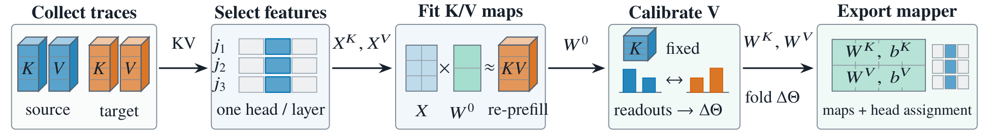
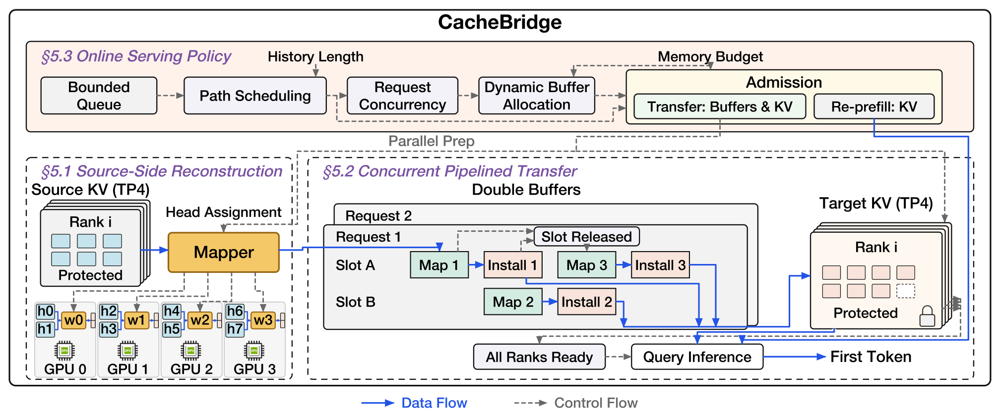

<h1 align="center">CacheBridge</h1>

<p align="center">
  <strong>Efficient Cross-Model KV Transfer for Multi-Model LLM Serving</strong>
</p>

<p align="center">
  <a href="https://arxiv.org/abs/2609.00891"></a>
  <a href="https://github.com/WHU-XingyuQu/CacheBridge/actions/workflows/cpu.yml"></a>
  <a href="pyproject.toml"></a>
  <a href="requirements/fitting.txt"></a>
</p>

<p align="center">
  <a href="https://arxiv.org/abs/2609.00891">Paper</a> ·
  <a href="#quick-start">Quick Start</a> ·
  <a href="docs/paper_pipeline.md">Pipeline</a> ·
  <a href="docs/fitting.md">Fitting</a> ·
  <a href="docs/serving.md">Serving</a> ·
  <a href="docs/extending.md">Extend CacheBridge</a> ·
  <a href="docs/agent_development.md">Agent Guide</a>
</p>

CacheBridge is a serving system that accelerates heterogeneous multi-model LLM
workloads through **cross-model KV transfer**. When routers, cascades or agent
workflows switch models, it reconstructs the target model's history KV from the
source cache to avoid re-prefilling the shared history. It co-designs a
**compact, attention-calibrated KV mapper** with an optimized online handoff
path to reduce latency and memory overhead while preserving task quality.

The paper presents four components:

- **Compact head assignment.** Reconstruct each target KV head from one source
  KV head per selected source layer using affine ridge maps, with head assignment
  co-designed for source-side reconstruction.
- **Attention-readout calibration.** Calibrate value maps against the target's
  attention readouts from re-prefill, keeping key maps and head assignment fixed
  and folding the corrections into the existing map coefficients.
- **Systematic optimization.** Pipeline reconstruction, transfer and direct
  installation into target paged KV storage with double buffering and bounded
  temporary memory.
- **Online serving policy.** Select transfer or re-prefill for each request and
  coordinate transfer concurrency and buffer allocation with serving demand and
  available GPU memory.

## How it works

### Fitting a Deployable KV Mapper · Section 4

<p align="center">
  <a href="assets/figures/offline_fitting.pdf"></a>
</p>

### CacheBridge System Design · Section 5

<p align="center">
  <a href="assets/figures/online_system.pdf"></a>
</p>

Offline fitting combines compact head assignment and initial ridge fitting with
layer-ordered attention-readout calibration. Online serving combines source-side
reconstruction, concurrent pipelined transfer and an online serving policy.
Source history stays protected during reconstruction, and the target prefix is
published only after every block and rank is ready. The model router chooses the
next model, and CacheBridge chooses how to prepare its history state.

See the [pipeline-to-code guide](docs/paper_pipeline.md) for stage boundaries
and the [architecture guide](docs/architecture.md) for resource lifetimes.

## Quick start

**Requirements:** Python 3.11+ and Git. The following setup runs the CPU examples
with synthetic tensors and a toy agent environment.

```bash
git clone https://github.com/WHU-XingyuQu/CacheBridge.git
cd CacheBridge

python -m venv .venv
source .venv/bin/activate
python -m pip install --upgrade pip
python -m pip install torch==2.7.1 --index-url https://download.pytorch.org/whl/cpu
python -m pip install -e .

python examples/fit_and_map.py
python examples/sample_trajectory.py
python examples/inspect_architecture.py
```

The examples cover fitting and applying a small mapper, sampling a routed
trajectory, and inspecting model structure. They run without model weights.
For model-backed fitting and serving, create a separate CUDA environment using
the [serving setup](docs/serving.md).

## Model support

The complete fitting and serving recipe uses **Qwen3-14B → Qwen3-32B**, with
**Source TP4 + Target TP4 on one eight-GPU host**. The reference environment uses
PyTorch 2.7.1, Transformers 4.54.1, CUDA 12.6 and a pinned SGLang 0.4.10.post2.

| Model family | Available architecture operations |
| :--- | :--- |
| Qwen3 | Model description and layerwise query execution; complete 14B → 32B recipe |
| Llama | Model description and full-attention layer execution |
| Ministral 3 | Model description and full-attention layer execution |
| Gemma 3 | Local/global KV layout, window materialization and cache installation |
| Qwen3.5 | Attention layout, recurrent-state transformation and cache installation |

Architecture operations are building blocks for new pairs. A complete pair
also requires a fitting recipe and a serving integration. See
[model adapters](docs/architectures.md) for the capability and dependency
boundaries; structured-cache helpers use a separate Transformers 5.15 environment.

## Offline: fit a mapper

The trajectory recipe consumes native TRAIN handoffs, paired KV snapshots and
an existing initializer that supplies the selected source layers and initial V
coefficients. Model weights, initializers and fitted mapper weights are external
inputs; see the [artifact format](docs/artifacts.md).

In the fitting environment:

```bash
cachebridge recipes

cachebridge fit prepare \
  --recipe qwen3_14b_32b_trajectory \
  --inputs /path/to/native-bank/inputs.jsonl \
  --target-model /path/to/Qwen3-32B \
  --initializer /path/to/initializer/weights \
  --output /path/to/new-fit

CUDA_VISIBLE_DEVICES=0,1,2,3 cachebridge fit run \
  --directory /path/to/new-fit \
  --mapper-id my-qwen3-mapper

cachebridge verify /path/to/new-fit/candidate.json
```

Use `--freeze-keys` during preparation to retain K coefficients while calibrating
value maps on a new trajectory bank. The [fitting guide](docs/fitting.md) covers
native sampling, continuation collection, input contracts and the calibration
objective.

## Online: serve with SGLang

SGLang is a **Git submodule**. CacheBridge's adapters and compatibility patch
are part of the Python package; preparation applies the patch to a separate
engine directory and keeps the upstream checkout clean.

```bash
git submodule update --init third_party/sglang
cachebridge backend prepare
```

Follow the [CUDA dependency setup](docs/serving.md#runtime-dependencies), then
copy the runtime configuration:

```bash
cp recipes/runtime.example.json recipes/runtime.local.json
```

Set `source_model`, `target_model`, `mapper_descriptor` and `engine_path` to your
local paths. Relative paths resolve against the configuration file. Then check
the configured backend and run the workload's functional gate:

```bash
cachebridge serve --config recipes/runtime.local.json --check

cachebridge serve --config recipes/runtime.local.json -- \
  python benchmarks/tau_bench/run.py evaluate \
  --tasks recipes/tau_test.json \
  --functional-only \
  --output /path/to/functional-check
```

The prepared engine defaults to `.cache/cachebridge/sglang`. For a source archive
or wheel installation, use `cachebridge backend prepare --fetch` to explicitly
obtain the same upstream commit. See [external modules](third_party/README.md).

## Agent trajectories and model routing

Implement the protocols in `cachebridge.agents` to connect another workload:

| Interface | Responsibility |
| :--- | :--- |
| `AgentEnvironment` | Task observations, tool execution and termination |
| `ModelRouter` | Select the next model from the current context |
| `AgentBackend` | Inference, token identities, cache handles and transfer |
| `sample_trajectory` | Record turns, route decisions and executed cache behavior |

Start with [the runnable sampling example](examples/sample_trajectory.py), then
follow the [trajectory API guide](docs/agent_trajectories.md). The included
τ-bench adapter supports native TRAIN collection and matched task evaluation:

```bash
cachebridge serve --config recipes/runtime.local.json -- \
  python benchmarks/tau_bench/run.py sample \
  --tasks recipes/tau_train.example.json \
  --output /path/to/native-bank

cachebridge serve --config recipes/runtime.local.json -- \
  python benchmarks/tau_bench/run.py evaluate \
  --tasks recipes/tau_test.json \
  --output /path/to/mapped-evaluation
```

Add `--native` to `evaluate` for target re-prefill under the same router.
Use `benchmarks/tau_bench/compare.py` for paired evaluation with official tool
and reward replay. See the [agent development guide](docs/agent_development.md).

## Repository layout

```text
src/cachebridge/
├── architectures/     # Model adapters and complete model-pair contracts
├── offline/           # Head assignment, ridge fitting, readout calibration, export
├── online/            # KV reconstruction, pipelined transfer and handoff coordination
├── backends/sglang/   # Engine adapter, runtime and compatibility patch
├── agents/            # Router/backend protocols and trajectory sampling
├── artifacts.py       # Mapper format and integrity checks
└── trajectory.py      # Exact-token trajectory format

third_party/sglang/    # Pinned external SGLang submodule
benchmarks/tau_bench/  # Workload adapter and official environment/scorer
recipes/              # Runtime configuration and task rosters
requirements/         # Separate dependency environments
examples/             # Small runnable examples
tests/                # Numerical, lifecycle and interface checks
docs/                 # Design, usage and extension guides
```

## Documentation

| Guide | Contents |
| :--- | :--- |
| [Pipeline and code](docs/paper_pipeline.md) | Offline/online stages and their implementations |
| [Architecture](docs/architecture.md) | Dependency boundaries and resource ownership |
| [Fitting](docs/fitting.md) | Trace collection, initial ridge fitting and attention-readout calibration |
| [Serving](docs/serving.md) | CUDA environment, SGLang setup and runtime configuration |
| [Model adapters](docs/architectures.md) | Family capabilities and cache-state operations |
| [Trajectory API](docs/agent_trajectories.md) | Agent integration and exact-token records |
| [Mapper artifacts](docs/artifacts.md) | Descriptor, tensor geometry and integrity checks |
| [Extension guide](docs/extending.md) | Add a model pair, agent workload or backend |
| [Agent development guide](docs/agent_development.md) | Trajectory sampling, fitting and evaluation |

## Development

```bash
python -m pip install -e '.[dev,fitting]'
python -m pytest
```

CPU CI covers numerical and lifecycle contracts, model adapters and installed
package entry points. Backend functional checks run separately in the CUDA
environment. See [CONTRIBUTING.md](CONTRIBUTING.md) for module ownership and
validation guidance.

The `cachebridge-fit`, `cachebridge-verify` and `integrations/sglang/run.py`
entry points remain available for compatibility.

## Acknowledgments and license

CacheBridge integrates [SGLang](https://github.com/sgl-project/sglang) and the
[τ-bench](https://github.com/sierra-research/tau-bench) environments and scorer,
and builds on PyTorch, Transformers and safetensors.

The project license is pending. Third-party components retain their upstream
licenses; see [license status](LICENSE_STATUS.md) and
[third-party notices](THIRD_PARTY_NOTICES.md).

## Citation

If you use CacheBridge in your research, please cite our paper:

```bibtex
@misc{qu2026cachebridge,
  title         = {{CacheBridge}: Efficient Cross-Model {KV} Transfer for Multi-Model {LLM} Serving},
  author        = {Qu, Xingyu and Lu, Siyuan and Chen, Zhiyu and Wang, Sheng and Lin, Tao},
  year          = {2026},
  eprint        = {2609.00891},
  archivePrefix = {arXiv},
  primaryClass  = {cs.AI},
  doi           = {10.48550/arXiv.2609.00891},
  url           = {https://arxiv.org/abs/2609.00891}
}
```
