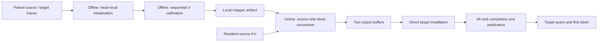

# Architecture

The package separates fitting from serving while keeping the artifact boundary
shared. This lets a collaborator change a fitting recipe without rewriting the
runtime, or implement a new serving adapter without importing fitting drivers.

Model-family descriptions and state operations live in `architectures/`.
Offline code consumes its layer executors and structural metadata; online
integrations consume its cache layout and installation contracts. See
[model architecture adapters](architectures.md) for family-specific operations.

This path is implemented for the qualified Qwen3-14B to32B pair. The package
contains the complete model-backed sequential fitter; the SGLang integration
contains source conversion, transport, direct installation and publication.

## Offline boundary

Offline code owns paired trace preparation, explicit source support,
head-local initialization, sequential conditional V calibration, and artifact
export. These stages must be separately visible in recipes: an initializer is
not a complete calibrated mapper. The low-level solver does not select a ridge
coefficient, source support, or a new scientific default.

The generic `offline/ridge.py` initializer retains two-pass centered sufficient
statistics, unscaled absolute ridge, FP32 by default, and an unregularized
intercept. The trajectory recipe uses the separately extracted FP64 weighted
centered solve in `offline/weighted_keys.py`. The
conditional calibration helper retains its existing relative regularization.
They are different objectives; do not combine their hyperparameters merely
because both solve linear systems.

Model execution and calibration input construction are isolated from this
algebra. A recipe identifies its inputs, model revisions, source-layer
support, precision, and calibration protocol. Generic FullQueryV, constrained
FusionV, and the later trajectory-calibrated artifacts retain distinct
provenance even when they share the same online tensor format.

## Online boundary

Online code consumes an external mapper directory and resident source KV. It
owns block conversion, bounded workspace, delivery, unpublished target pages,
publication, cancellation, and resource lifetimes. A serving adapter supplies
the engine's allocator, radix pins, streams/events, collectives and scheduler
callbacks. Model paths, ports, device assignments and output directories belong
in explicit configuration, not in package import side effects.

Preserve these existing invariants when connecting the primitives:

- Keep source KV immutable and pinned until all producer reads and consumer
  acknowledgements complete.
- Reuse an output slot only after its consumer GPU reads complete; a Python
  callback returning is not proof of CUDA completion.
- Keep target pages unpublished until every block and every target rank are
  ready. Allocation and publication belong to the scheduler.
- Retain ownership on uncertain distributed failure; do not report a safe
  rollback without proof that outstanding GPU operations have completed.
- Keep the mapped-output buffers on the source. Direct placement eliminates
  history-sized target staging; it does not mean zero total request memory.

`online.blocks.install_unpublished` is a synchronous transaction reference.
`online.pipeline.PipelinedSourceLease` describes slot ownership, not stream
execution. `online.admission` is an extracted earlier single-transaction policy.
The shared mapper algebra is used by both public APIs and the backend.
The generic handoff coordinator lives in `online/handoff.py`;
`backends/sglang/handoff.py` supplies RPCs and scheduler receipts.
The actual multi-GPU pipeline is implemented in
`src/cachebridge/backends/sglang/runtime/source_mapper_adapter.py` and its peer/publication
adapters. These contain the engine implementation and compatibility
modules; a change to a public reference utility does not automatically change
that runtime. Use the integration's GPU gates when changing serving behavior.
Importing offline algebra does not require SGLang.

## Benchmarks

The serving timing boundary is handoff arrival to the first host-visible token.
Source history KV may already be resident; target history starts empty. Charge
all post-arrival conversion, delivery, installation, synchronization, queueing,
publication and query work. Keep correctness/profiling runs separate from
uninstrumented timing, and use matched native re-prefill for each model pair.

## Dependency direction

`architectures`, artifact formats and trajectory formats are shared contracts.
Offline fitting and online coordination depend on those contracts independently.
The SGLang backend depends on online primitives; the primitives do not import
SGLang. Agent sampling uses protocols, and workload adapters supply concrete
implementations. See [extension guidance](extending.md).

The upstream engine is a pinned submodule. Patches and preparation tools belong
to the backend package; prepared engine files and generated artifacts are ignored
by Git and excluded from distributions.
